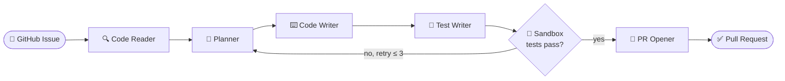
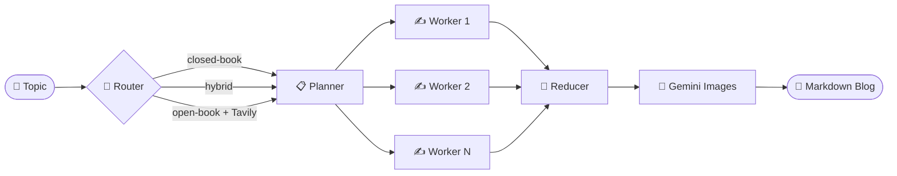

<!-- ===================================================== -->
<!--            SATVIK SHANKAR SINGH / PROFILE             -->
<!-- ===================================================== -->

<p align="center">
  
</p>

<p align="center">
  <a href="https://git.io/typing-svg">
    
  </a>
</p>

<p align="center">
  <a href="https://www.linkedin.com/in/satvik1221"></a>
  <a href="mailto:sanu8800971634@gmail.com"></a>
  <a href="mailto:ss7225@srmist.edu.in"></a>
  <a href="https://www.spazorlabs.com"></a>
</p>

<p align="center">
  
  
</p>

---

# 🧠 `whoami`

```text
╔══════════════════════════════════════════════════════════════════╗
║                                                                  ║
║   NAME        →  Satvik Shankar Singh                            ║
║   ROLE        →  Agentic AI & LLM Engineer                       ║
║   BASE        →  Chennai, India  ·  SRM University (ECE + DS)    ║
║   GRAD        →  2028                                            ║
║   STACK       →  LangGraph · RAG · FastAPI · Docker · PyTorch    ║
║   OSS         →  Aden Hive (YC-backed agent framework)           ║
║   MODE        →  BUILD → BREAK → EVALUATE → SHIP                 ║
║                                                                  ║
║   STATUS      →  ██████████████████████████░░░  SHIPPING AGENTS  ║
║                                                                  ║
╚══════════════════════════════════════════════════════════════════╝
```

I build **autonomous LLM systems**: agents that plan, retrieve, call tools, write code, run tests and open pull requests, with no hand-holding.

My focus is taking agentic systems from *research prototype* to *deployed product*, backed by a foundation in deep learning, NLP and computer vision.

---

# ⚡ `currently.log`

| 🔭 Now | 🧪 Researching | 🤝 Open to |
|:---|:---|:---|
| **Sherlock.ai**: ML datasets & detection for deepfake / AI-assisted-cheating detection in remote interviews | **SpazorLabs**: quantum-enhanced ML, variational circuits, hybrid benchmarking | Agentic AI products, RAG & eval infra, LLM dev tools, hackathons, OSS |

---

# 🚀 `featured_projects`

## 🤖 Multi-Agent GitHub Issue Resolver

> Give it an issue. It reads the repo, plans a fix, writes code, writes tests, runs them in a sandbox and opens a PR.



`LangGraph` `LangChain` `Gemini API` `PyGithub` `Docker`

- Five specialized agents sharing a **TypedDict state graph** with conditional edge routing
- **RAG-lite** codebase traversal + structured fix planning
- Progressive retries (up to 3), **circuit breaker**, cost tracking
- Generated code runs **only inside Docker**, never on the host
- **58 passing tests**

<p align="center">
  <a href="https://github.com/Satvik12221as/Github-Agent-System">
    
  </a>
</p>

## ✍️ Autonomous Blog Writing Agent

> Topic in, researched, illustrated Markdown blog out. Zero human input.



`LangGraph` `Groq` `Tavily` `Gemini API` `Streamlit`

- **Adaptive router** picks closed-book / hybrid / open-book based on topic recency & complexity
- **Fan-out / fan-in** parallel section writers, merged by a Reducer stage
- Images generated and embedded contextually, deployed on Streamlit

<p align="center">
  <a href="https://github.com/Satvik12221as/Blog-Writing-AI-Agent">
    
  </a>
</p>

## 🌐 Open Source and Product

<p align="center">
  <a href="https://github.com/Satvik12221as/hive">
    
  </a>
  <a href="https://github.com/Satvik12221as/medibridge">
    
  </a>
</p>

- **Hive** (Aden): YC-backed autonomous agent framework with 9.5k+ stars and 183 contributors. I contribute to agent tooling, issue resolution and framework improvements across the Python multi-agent runtime and SDK-wrapped node ecosystem.
- **Medibridge**: JavaScript product build focused on practical user flows and clean interface structure.

---

# 🧬 `tech_loadout`

### 🤖 Agentic AI and LLM
<p>
  
  
  
  
  
  
  
  
</p>

### ⚔️ Languages, Backend and Cloud
<p>
  
</p>

### 🧪 ML, Vision and Data
<p>
  
  
  
</p>

---

# 🏗️ `engineering_depth`

| 🧠 Agentic Systems | 🔎 RAG & LLM Pipelines |
|:---|:---|
| Multi-agent orchestration, ReAct / MRKL reasoning, stateful workflow graphs, conditional routing, fan-out execution, agent memory, retry loops, circuit breakers | Semantic search, retrieval routing, context composition, prompt engineering, structured outputs, vector stores (Pinecone, ChromaDB) |

| ⚙️ Backend & Delivery | 👁️ ML, CV & Audio |
|:---|:---|
| FastAPI, Flask, Django, REST, SQLAlchemy, PostgreSQL, Docker, AWS EC2/S3, Render, Vercel, Swagger | CNNs, Transformers, RNNs, OpenCV, segmentation, video/audio signal analysis, deepfake detection, model evaluation |

---

# 🛣️ `experience.log`

```text
2026-06 → 2026-08   AI Research Intern        Sherlock.ai    deepfake / proxy-candidate detection datasets
2026-03 → present   Open Source Contributor   Aden Hive      YC-backed autonomous agent framework
2025-11 → 2026-01   Research & Tech Intern    SpazorLabs     quantum-classical AI research
2025               Internship Selection       NIT Calicut    competitive national selection
```

---

# 📊 `developer_telemetry`

<p align="center">
  
</p>

<p align="center">
  
</p>

<p align="center">
  
  
  
</p>

<p align="center">
  
</p>

<p align="center">
  
</p>

---

# 🌐 `open_connection()`

<p align="center">
  
</p>

<p align="center">
  <a href="mailto:ss7225@srmist.edu.in"><b>✉️ Build with me</b></a> ·
  <a href="https://www.linkedin.com/in/satvik1221"><b>🔗 LinkedIn</b></a> ·
  <a href="https://github.com/Satvik12221as?tab=repositories"><b>📦 Repositories</b></a>
</p>

<p align="center">
  
</p>

<p align="center">
  <b>PLAN → RETRIEVE → CODE → TEST → SHIP → REPEAT</b><br/>
  <sub>Still building. Still learning. Still shipping.</sub>
</p>
